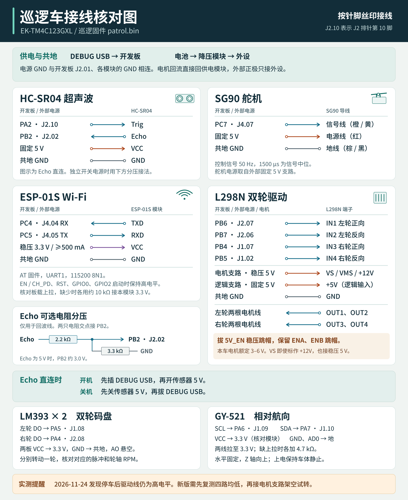

# 巡逻车逐针对接表

适用于红色 **EK-TM4C123GXL**、双直流减速电机（用户确认 **3–6 V**）、L298N 四输入模块、SG90、HC-SR04、带 AT 固件的 ESP-01S、左右各一只单通道 LM393 槽型测速板和 GY-521。J2.07 表示 J2 排针第 7 脚。看开发板正面，DEBUG USB 朝上，先找针脚旁的 PB6 等丝印，再核对编号。旧照片绿色底板上的 STM32 接口布局不同。



放大核查针脚可用[矢量接线图](wiring.svg)。ESP-01S 按当前固件标注，本次台架试验未验证 Wi-Fi 链路。

## 电源与地

所有接头在 USB 和电池均断开时安装。先让降压模块单独上电，用直流电压档确认各输出对 GND 的极性和值，再断电接线。电源模块固定 5 V、可调 VADJ、3V3 是不同支路，不能凭排针颜色判断正负。

| 从 | 到 | 说明 |
|---|---|---|
| 电池 | 降压模块输入 + / − | 按模块丝印确认 |
| 降压模块稳压 **5 V** 电机支路（可调支路预调到 5 V） | L298N 的 VMS / VS / 标作「+12V」的电机电源端 | 本车从 5 V 开始，供电上限 6 V；2S 电池不能直连这个端子 |
| 降压模块固定 **5 V** | L298N 的逻辑 +5V | 常见红色模块先**拔掉 5V_EN / 5V-ENABLE**，确认该端子此时为逻辑输入。保留另两个 **ENA、ENB** 跳帽 |
| 固定 **5 V** | SG90 红线、HC-SR04 VCC | 分支供电，给舵机启动电流留余量 |
| 独立稳压 **3.3 V** | ESP-01S VCC | 建议可供 ≥500 mA；确认照片中 3V3 支路有足够余量，否则另用稳压器。禁止给裸模块加 5 V |
| 电源 GND | L298N GND、SG90 棕/黑线、HC-SR04 GND、ESP-01S GND、LM393 GND、GY-521 GND、LaunchPad **J2.01 GND** | 也可用 J3.02 GND。电机和舵机的回流分别回电源，勿经 LaunchPad 排针 |
| USB 主机或 USB 移动电源 | LaunchPad 标 DEBUG 的 USB；电源选择置 DEBUG | 开发板独立供电。外部 5 V 和 3.3 V 正极都不要再接 LaunchPad 电源针 |

## 信号与车轮

| 模块针脚 | 接到 | 用途 |
|---|---|---|
| L298N IN1 | **PB6 / J2.07** | 左轮正向 PWM |
| L298N IN2 | **PB7 / J2.06** | 左轮反向 PWM |
| L298N IN3 | **PB4 / J1.07** | 右轮正向 PWM |
| L298N IN4 | **PB5 / J1.02** | 右轮反向 PWM |
| L298N OUT1、OUT2 | 左轮两根线 | 架空试前进。若左轮反转，断电对调这两根 |
| L298N OUT3、OUT4 | 右轮两根线 | 同法确认右轮 |
| SG90 黄/橙线 | **PC7 / J4.07** | 50 Hz 控制，1500 µs 探头应朝正前方，1900 µs 应朝小车左侧 |
| HC-SR04 Trig | **PA2 / J2.10** | 开发板输出 3.3 V 触发脉冲 |
| HC-SR04 Echo | **PB2 / J2.02** | 可经电阻分压，也可按下方供电顺序直连 |
| ESP-01S TXD | **PC4 / J4.04（U1RX）** | ESP → TM4C，3.3 V UART |
| ESP-01S RXD | **PC5 / J4.05（U1TX）** | TM4C → ESP，115200 8N1 |
| ESP-01S EN/CH_PD、RST、GPIO0、GPIO2 | 正常启动时保持高电平 | 核对实际模块的上拉，缺少时分别用约 10 kΩ 拉至 ESP 自己的 3.3 V。正常运行时 GPIO0 不接地 |

### 双轮码盘和 IMU

| 模块针脚 | 接到 | 安装与核对 |
|---|---|---|
| 两块 LM393 的 VCC、GND | 外部稳压 3.3 V、共地 | 使用支持 3.3 V 的测速板。核查 DO 高电平约 3.3 V |
| 左轮 LM393 DO | **PA5 / J1.08** | 左轮装码盘，槽口通过光电间隙，计一个上升沿。AO 留空 |
| 右轮 LM393 DO | **PA4 / J2.08** | 右轮码盘对准槽口。两个 DO 独立，AO 留空 |
| GY-521 VCC、GND | 外部 3.3 V、共地 | 核查所购模块支持此输入，实测芯片供电及总线上拉电压 |
| GY-521 SCL | **PA6 / J1.09** | I2C1 SCL，100 kHz |
| GY-521 SDA | **PA7 / J1.10** | I2C1 SDA。SCL、SDA 各需上拉至 3.3 V；模块缺少上拉时各加约 4.7 kΩ |
| GY-521 AD0 | GND | 7 位地址 0x68，INT、XDA、XCL 留空 |

IMU 水平固定于车体，Z 轴朝上。上电将车放稳，静止约 1–2 秒完成零偏采样。用手把车头向左转约 90°，手机的相对航向应增加约 90°。手机点「遥测」看 wheel_counts。只转左轮一整圈，应只有第一个计数增加；再单独转右轮，只有第二个计数增加。左右轮各自的初始参数均按每圈 20 脉冲、轮周 204.2 mm、轮距 135 mm；在平地推行一米，按「实测距离 ÷ 脉冲增量」校准每脉冲距离。图中码盘按轮轴安装，显示轮轴 RPM。若装在减速前的电机轴，填写每车轮转对应的总脉冲数，并按减速比换算电机轴 RPM。调整[标定参数](firmware/calibration.h)后重新构建并烧录。单路码盘记录无符号轮程，举车空转也会累计。航向以启动姿态为零，随时间漂移。[TI 排针表](https://www.ti.com/lit/ug/spmu296/spmu296.pdf#page=9) · [MPU-6050 寄存器手册](https://invensense.tdk.com/wp-content/uploads/2015/02/MPU-6000-Register-Map.pdf)

### HC-SR04 Echo 接线与供电顺序

**无电阻直连时**，将 Echo 接到 **PB2（J2 第 2 脚）**，传感器、降压模块和开发板共地。每次按以下顺序操作：

1. **开机**先插开发板 DEBUG USB，确认板上电源灯亮，再打开 HC-SR04 的 5 V 电源。
2. **关机**先关闭 HC-SR04 的 5 V 电源，再拔开发板 USB。中途需要拔 USB 时也按这个顺序操作。

当前巡逻固件将 PB2 配置为数字输入。主控正常供电时，该脚可接收 5 V 高电平。两路电源独立，先拔 USB 可能使 Echo 在主控掉电后仍向 PB2 输出 5 V。TI 对这种状态规定了累计时间上限。[TI TM4C123GH6PM 数据手册，第 1385 页](https://www.ti.com/lit/ds/symlink/tm4c123gh6pm.pdf#page=1385)

**两路电源可能独立开关时**，用下图的电阻分压接法：

```text
HC-SR04 Echo ── 2.2 kΩ ──●──── PB2 / J2.02
                         │
                       3.3 kΩ
                         │
                        GND
```

Echo 为 5 V 时，● 处约 3.0 V。Trig 与 Echo 分别走线。直接用 HC-SR04 上标注 VCC、Trig、Echo、GND 的那组针。不要将旧转接板的 P2.7 当作 TM4C 针脚。ESP PROG USB 转串口底板用于单独调试，在车上不要让它的 TX 与 MCU 的 TX 同时驱动 ESP RX。板上 R9/R10 可把 PB6/PB7 接至 PD0/PD1，这两个 PD 脚留空。

## 第一次通电

**2026-11-24 停车异常**。架空试转时，固件已报告左右轮指令为零，PB6 和 PB5 仍读到高电平。已通过 USB 临时将四路清零。新版在 PWM 切回 GPIO 后再次写入停车电平。固件在停车时读回四路，若复写后仍高，锁定驱动至复位并记入日志。先断开电机支路，只给驱动逻辑供电，逐一测量 IN1–IN4。前进、左右转后分别用停车键、SW1 和断网触发停车，均应读到四路低电平。通过后再接通电机支路架空试转。[台架记录](bench/2026-11-24.md)

1. 用正常的替换板。先接 DEBUG USB，电机支路断开；确认开发板电源灯正常，再给传感器和 ESP 供电。
2. 打开手机 App，开启手机 2.4 GHz 热点，点「连接 → 等待小车 → 新测区」检查遥测。用硬纸板依次放在探头前方 20、50、100 cm，核对前距。单独遮左侧、右侧，核对 App 显示的方向。中位朝向、左右角度以实测填写；若反向，交换固件扫描脉宽表的左右值。
3. 架空两轮，接通电机支路。传感器三向放在有回波且足够远的物体前，短按、松开「前进」，再分别测试左右转、板上 SW1、手机停车和断网。启动抖动时检查每个 IN 的复位电平，模块如无下拉可各加 10 kΩ 到 GND。
4. 放在平地，以宽纸箱代墙，实测停车距离，留出车头到探头的安装偏移、采样延迟和车轮滑行余量。重复测试斜墙、椅腿、低矮杂物和边缘；本车没有下视防跌落传感器，只在隔离楼梯的平地有人看护试车。
5. 先关闭电机和外设电源，再拔 USB。若板不亮或异常发热，断开两路电源排查。之前报过 3V3 对地约 0.5 Ω 的故障板保持断电。

引脚表取自 [TI LaunchPad 手册表 2-3 至 2-6](https://www.ti.com/lit/ug/spmu296/spmu296.pdf)。ESP 供电见[乐鑫 ESP8266 硬件说明](https://docs.espressif.com/projects/esp-techpedia/en/latest/esp-friends/get-started/try-firmware/try-firmware-hardware/esp8266.html)。[原舵机安装与中位说明](../servo_sg90/WIRING.md)记录了此前在替换板上的单舵机实测。
